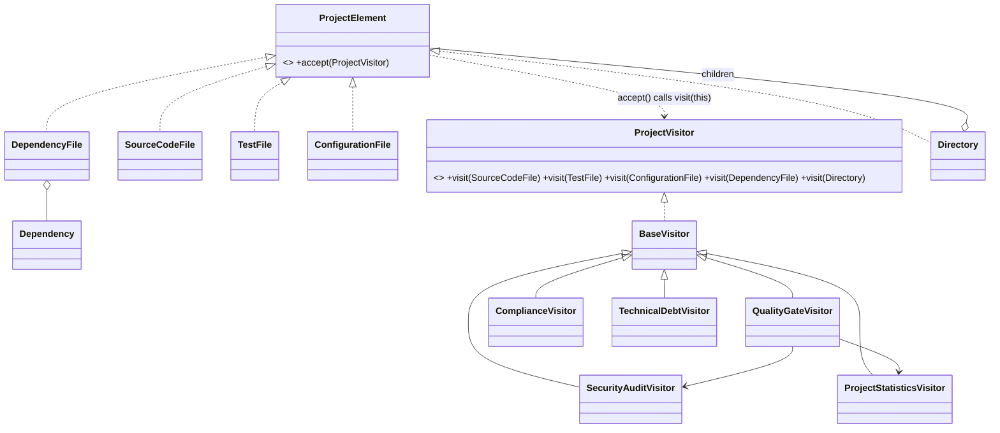
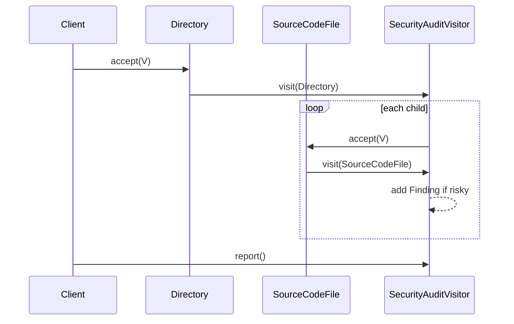

# Smart Code Inspection & Compliance Engine (Visitor Pattern)

Java 17 + Maven + JUnit 5. Run the demo: `mvn -q compile exec:java -Dexec.mainClass=inspection.Demo` (or run `inspection.Demo` from an IDE). Run tests: `mvn test`.

## Structure
- **Elements** (`inspection.model`): `ProjectElement`, `SourceCodeFile`, `TestFile`, `ConfigurationFile`, `DependencyFile`, `Directory` (composite), `Dependency`.
- **Visitors** (`inspection.visitor`): `ProjectVisitor`, `BaseVisitor` (traversal), `SecurityAuditVisitor`, `ProjectStatisticsVisitor`, `QualityGateVisitor`, `ComplianceVisitor`, and the extra `TechnicalDebtVisitor` (separate commit, no element changes).

## UML

### Class diagram

### Sequence diagram (SecurityAuditVisitor over a Directory)

## Answers

**1. What problem does Visitor solve?** Security audit, statistics, quality gate, compliance and technical debt all work on the same element types. Visitor keeps these operations out of the element classes, so elements stay small data holders and a new operation is just a new class.

**2. Where are Element and Visitor?** Elements: `inspection.model.ProjectElement` + 5 concrete classes. Visitors: `inspection.visitor.ProjectVisitor` + concrete visitors.

**3. What is double dispatch?** The method executed depends on two runtime types: the element and the visitor. `element.accept(visitor)` is resolved by the element's runtime type; inside it `visitor.visit(this)` is resolved by the visitor's runtime type, and the overload is chosen from the compile-time type of `this` (e.g. `SourceCodeFile`). No `instanceof` or `switch` is needed.

**4. Why not put all operations into the elements?** Every new operation would modify every element class (violating Open/Closed), mix unrelated concerns (security, stats, compliance) into data classes, and make the elements hard to test and reuse.

**5. Easier to add a new Visitor or a new Element?** A new Visitor: one new class, no existing code touched (see `TechnicalDebtVisitor`). A new Element is harder, see below.

**6. When is Visitor a bad choice?** When the element hierarchy changes often (each new element touches the visitor interface and all visitors), when there are only one or two operations, or when visitors need access to element internals that would have to be exposed.

**7. Visitor vs Strategy?** Strategy swaps one algorithm of a single object (the context chooses it, usually one interchangeable behavior behind one interface). Visitor adds many operations over a whole structure of different element types and dispatches by element type.

**8. SOLID principles:**
- **S**: each visitor has one job; elements only hold data.
- **O**: new operations are added without modifying elements (`TechnicalDebtVisitor`).
- **L**: all visitors and elements can be used through their interfaces.
- **I**: small interfaces (`ProjectElement` has one method).
- **D**: elements depend on the `ProjectVisitor` abstraction, not on concrete visitors.

## Visitor limitation: adding `DatabaseMigrationFile`
Required changes:
1. New class `DatabaseMigrationFile implements ProjectElement` with `accept()` calling `visitor.visit(this)`.
2. Add `void visit(DatabaseMigrationFile file)` to `ProjectVisitor`.
3. Every class implementing `ProjectVisitor` must handle it. Here the 5 visitors extend `BaseVisitor`, so adding a no-op default there is enough for compilation, and only visitors that care (e.g. Security, Compliance) get real logic. A direct `ProjectVisitor` implementer (like the anonymous one in the tests) would break.

So Visitor is convenient when **operations are added often but the element structure rarely changes**; the opposite case makes it painful.

## Git history
See `git log --oneline` (10 commits: setup, elements, statistics, security, quality gate, compliance, demo, extra visitor, tests, README).
